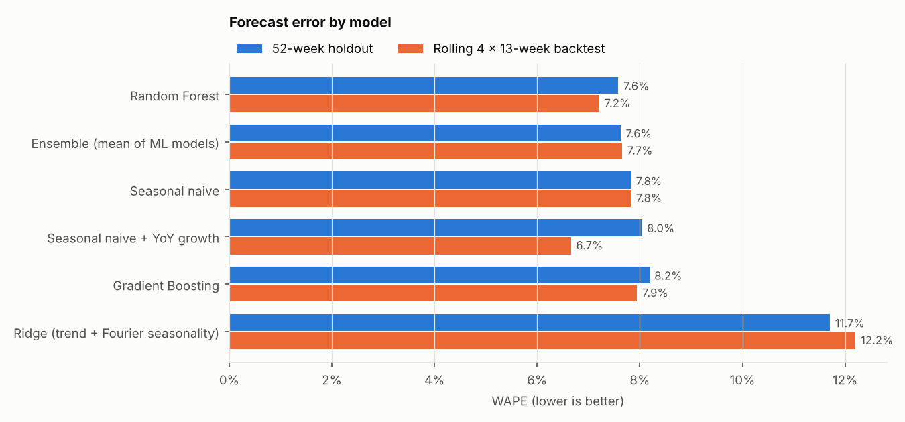
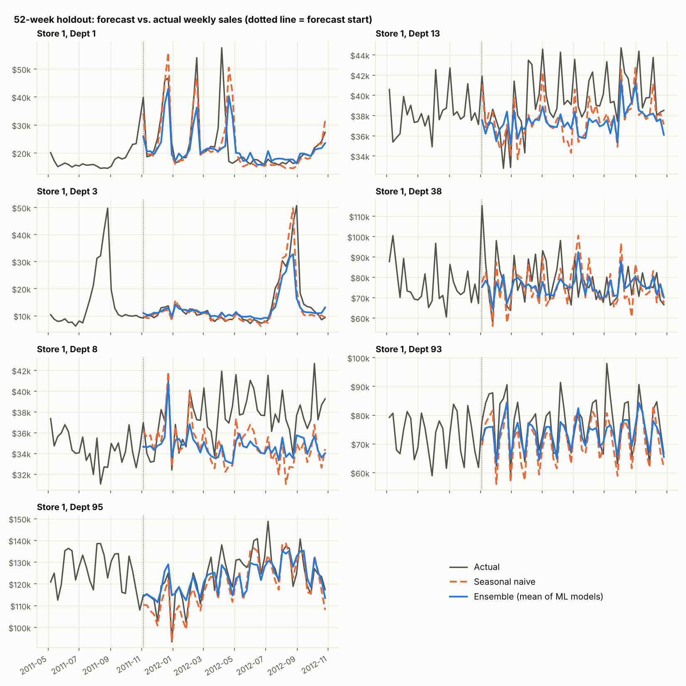
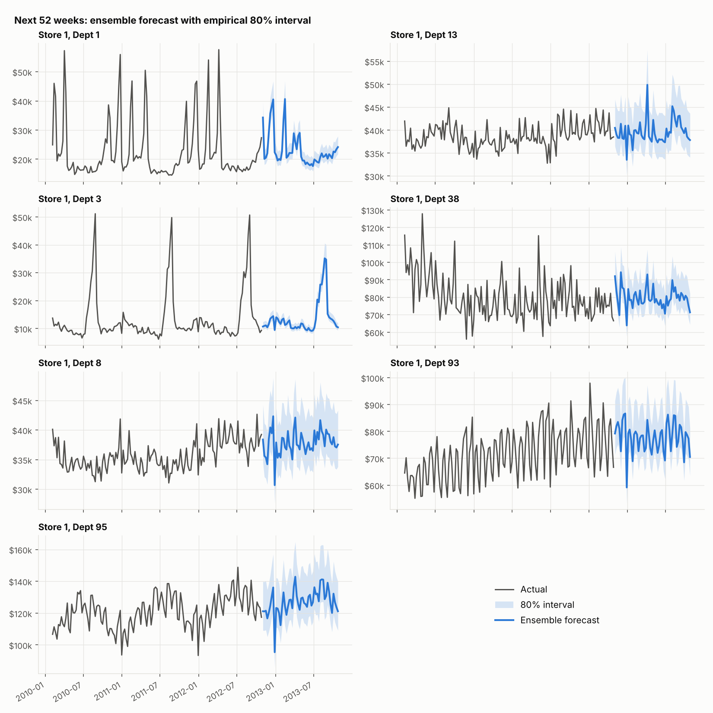

# Multi-Series Weekly Sales Forecasting

Forecasting 52 weeks of weekly sales for 7 Walmart store-department series, with
machine-learning models benchmarked against seasonal-naive baselines using a
long-range holdout and a rolling-origin backtest.



## Business question

How much do machine-learning models improve on simple "same week last year"
forecasts for weekly department sales, and does the answer change with the
planning horizon (quarterly vs. annual)?

## Data

`data/walmart_sales_weekly.csv`: weekly sales for Store 1, departments 1, 3, 8,
13, 38, 93 and 95, from Feb 2010 to Oct 2012 (7 series x 143 weeks = 1,001 rows),
with Walmart's holiday-week flags (Super Bowl, Labor Day, Thanksgiving,
Christmas). It is the `walmart_sales_weekly` dataset from the R package
[timetk](https://github.com/business-science/timetk), taken from the Kaggle
*Walmart Recruiting: Store Sales Forecasting* competition.

## Approach

**Feature engineering** (`src/features.py`)
- Calendar: week of year, month, a linear trend, and Fourier terms (3 harmonics)
  for annual seasonality
- Holidays: Walmart's holiday flag split by holiday, plus "weeks until
  Christmas" indicators. Christmas falls in a different week each year, so a
  plain same-week-last-year lag misaligns it.
- `lag_52` (same week last year). Every feature is known at least 52 weeks
  ahead, so models forecast the whole year directly, without feeding their own
  predictions back in and without leaking information from the forecast period.
- Excluded on purpose: CPI, fuel price, temperature and markdowns. They aren't
  known at forecast time, and the markdown fields are missing before Nov 2011.

**Models** (`src/models.py`)

| Model | Type |
|---|---|
| Seasonal naive | Baseline: sales in the same week last year |
| Seasonal naive + YoY growth | Baseline: scaled by each series' last-13-week year-over-year growth |
| Ridge regression | Global linear model: trend + Fourier seasonality + holidays |
| Random Forest | Global tree ensemble on calendar, holiday and lag features |
| Gradient Boosting | Global histogram gradient boosting, same features |
| Ensemble | Mean of the Ridge, Random Forest and Gradient Boosting forecasts, fixed before seeing any results |

The ML models are *global*: one model is trained across all 7 series on
scale-normalised sales (each series divided by its training mean), so series
share seasonal and holiday patterns.

**Validation** (`src/run_forecast.py`)
1. **52-week holdout:** train on the first 91 weeks, forecast the final 52.
2. **Rolling-origin backtest:** 4 expanding-window folds, each forecasting the
   next 13 weeks (a quarterly planning horizon).

**Metrics** (`src/metrics.py`): WAPE (total absolute error / total sales, the
headline metric), MAPE, MAE, RMSE, MASE (relative to in-sample seasonal-naive
error) and bias (positive = over-forecast).

## Results

### 52-week holdout (Nov 2011 to Oct 2012)

| Model | WAPE | MAPE | MAE | RMSE | Bias |
|---|---:|---:|---:|---:|---:|
| **Random Forest** | **7.58%** | 9.12% | $4,247 | $6,582 | -3.2% |
| Ensemble | 7.63% | 9.20% | $4,272 | $6,660 | -3.5% |
| Seasonal naive | 7.83% | 9.01% | $4,384 | $6,724 | -4.6% |
| Seasonal naive + YoY growth | 8.04% | 9.82% | $4,503 | $7,007 | -2.9% |
| Gradient Boosting | 8.18% | 10.07% | $4,585 | $7,466 | -3.0% |
| Ridge | 11.71% | 14.98% | $6,557 | $9,409 | -4.4% |

### Rolling backtest (4 folds x 13 weeks)

| Model | WAPE | Fold-to-fold SD | MAE | Bias |
|---|---:|---:|---:|---:|
| **Seasonal naive + YoY growth** | **6.66%** | 0.92 | $3,729 | -0.4% |
| Random Forest | 7.21% | 1.12 | $4,039 | -2.4% |
| Ensemble | 7.66% | 0.82 | $4,289 | -3.0% |
| Seasonal naive | 7.83% | 1.00 | $4,384 | -4.6% |
| Gradient Boosting | 7.95% | 0.97 | $4,451 | -3.2% |
| Ridge | 12.21% | 1.62 | $6,837 | -3.3% |

Full tables, including per-series and per-fold results, are in `reports/metrics/`.



## Findings

1. **The baseline is hard to beat.** On the 52-week holdout, Random Forest
   reduced WAPE by about 3% relative to seasonal naive (7.58% vs. 7.83%). Most
   of that gain comes from the two highest-volume departments (93 and 95).
   Seasonal naive was more accurate on 5 of the 7 series.
2. **The best model depends on the horizon.** For 13-week forecasts, the
   growth-adjusted seasonal naive was the most accurate (6.66% WAPE) and nearly
   unbiased (-0.4%). Adjusting for recent year-over-year growth helps over a
   quarter, but the adjustment goes stale over a full year.
3. **Every model under-forecasts.** Bias ranges from -0.4% to -4.6%, because
   Feb–Oct sales in 2012 ran 2–11% above 2011 in all 7 departments. Unadjusted seasonal naive
   repeats last year's lower level, so it has the largest bias.
4. **Smooth seasonality isn't enough.** The Ridge model with Fourier terms
   cannot reproduce sharp, department-specific peaks (back-to-school in Dept 3,
   holiday spikes in Dept 1), so it has the highest error.
5. **Recommendation:** use growth-adjusted seasonal naive for quarterly
   planning and Random Forest for annual planning, and recheck the choice as
   more history accumulates. With only 2.75 years of data, the ML models
   train on 39 weeks of lagged history per series in the holdout.

## 52-week forward forecast

The ensemble is refit on all 143 weeks and forecasts Nov 2012 to Oct 2013. The
80% interval comes from the ensemble's actual-to-forecast ratios in the rolling
backtest (10th to 90th percentile: 0.90x to 1.15x). Output:
`reports/metrics/future_52wk_forecast.csv`.



## Limitations and next steps

- **Moving holidays:** Easter moves between March and April, and Dept 1's
  Easter peak lands in the wrong week under any same-week-last-year logic. An
  Easter-week feature is the most direct fix.
- **Ensemble shrinks peaks:** averaging Ridge into the ensemble flattens sharp
  seasonal peaks (visible in the Dept 3 forward forecast). Selecting ensemble
  members on an earlier validation window would likely help.
- **Short history:** 143 weeks per series is little for ML. Pooling more stores
  and departments from the full Kaggle dataset would test whether the ML
  advantage grows.
- **Simple intervals:** the intervals are a single pooled error band. Quantile
  models or per-series conformal intervals would be better calibrated.

## How to run

```bash
pip install -r requirements.txt
python src/run_forecast.py
```

Tested with Python 3, pandas 3.0, scikit-learn 1.9 and matplotlib 3.11. The run takes about 15 seconds and writes all metrics to `reports/metrics/` and
all figures to `reports/figures/`. `reports/run_log.txt` contains the console
output of the run that produced the committed results.

## Project structure

```
data/walmart_sales_weekly.csv     input data
src/features.py                   calendar, holiday and lag features
src/models.py                     baselines, global ML models, ensemble
src/metrics.py                    WAPE, MAPE, MAE, RMSE, MASE, bias
src/plots.py                      report figures
src/run_forecast.py               end-to-end pipeline
reports/metrics/                  results tables (CSV)
reports/figures/                  charts
Time Series Forecasting with Nest + Modeltime.R
                                  original R prototype (tidymodels / modeltime)
```

The original R prototype used Prophet, XGBoost, Random Forest and SVM through
modeltime on the same data. This Python version adds seasonal-naive baselines,
leakage-free direct features, a rolling-origin backtest, a full set of error
metrics and saved, reproducible results.
